# v1.3.0 Final Pre-Release Verification

**Status:** Automated Windows validation passed. Publication remains pending review of the documented test limits and local artifact provenance. No v1.3.0 tag or release was created.

## Tested source and environment

- Repository: `REMEDIOSSAMUEL/EYE-BREAK-REMINDER`
- Branch: `feature/v1.3.0-custom-accent-colours`
- Exact source commit tested: `ee480056d05a19eaa10907ad9f4fd96c3373db04`
- Hosted validation run: [run 43526976563](https://github.com/REMEDIOSSAMUEL/EYE-BREAK-REMINDER/actions/runs/43526976563)
- Windows: GitHub-hosted Windows Server 2025 Datacenter, build 26100, x64, interactive Explorer desktop
- Installer/product version: 1.3.0

The completed run passed. The current source changes after the tested commit are limited to this verification report, its committed evidence, and a path filter that prevents evidence-only commits from repeating the two-hour soak. No product source changed after the tested commit.

## Result totals

| Suite | PASS | FAIL | NOT TESTED | Notes |
|---|---:|---:|---:|---|
| Core tests | 20,100 | 0 | 0 | 6,700 assertions on each of `make test`, `make all`, and `make package` |
| Package verification | 94 | 0 | 0 | Binary/package checks from the Windows build |
| Native GUI acceptance | 519 | 0 | 0 | 627 additional PASS event records; event rows are not added to assertion totals |
| Installed-app, installer, upgrade and lifecycle acceptance | 613 | 0 | 13 | 13 runner/hardware/UI-observability limits listed below |
| Long resource soak | 263 | 0 | 0 | 110 complete cycles, 100 real ChooseColorW operations |
| **Counted assertion/check executions** | **21,589** | **0** | **13 recorded + 2 scope gaps** | The 2 additional scope gaps are active-Break process restart and a genuine Windows reboot |

The build step ran the requested `make test`, `make all`, `make package`, and `make gui-test` targets. The GUI and installed-app acceptance scripts then exercised the built application on the interactive runner. The GUI event log contains 627 PASS events in addition to its 519 assertions; these are not double-counted in the total above.

## High Contrast, Forced Colors and accessibility

**PASS:** The GUI acceptance test enabled Windows High Contrast through the real system `SPI_SETHIGHCONTRAST` API on the isolated Windows runner, checked the state through `SPI_GETHIGHCONTRAST` (flags 127), captured the system palette, and restored the original Windows setting afterward. This was an OS-level test, not only an application-theme switch.

**PASS:** All five application themes were exercised: Follow Windows, Light, Dark, High Contrast Dark, and High Contrast Light. In the two High Contrast themes, custom accents were overridden while saved preferences remained intact. Pixel sampling confirmed the high-contrast Work and Break rings rendered their accessible system colors. Windows Forced Colors kept Work and Break labels distinct, and disabling it restored the saved custom colors and rendered rings.

Measured contrast in the active Windows Forced Colors palette:

| Element | Foreground | Background | Contrast |
|---|---|---|---:|
| Window text | `#FFFFFF` | `#202020` | 16.29:1 |
| Primary button text | `#263B50` | `#8EE3F0` | 7.89:1 |
| Focus indicator | `#8EE3F0` | `#202020` | 11.17:1 |

**PASS:** Keyboard focus was visible in Appearance settings. Timer status remained centered. Status text continued to identify Work and Break states, so state was not communicated only through color. Extreme and identical/similar color combinations remained readable and the selected swatches and values were retained.

DPI/text scaling: installed app checks covered 96 DPI and the earlier 144-DPI setup recorded by the acceptance harness. Windows text scaling at 150% changed the observed button height from 36 to 45 pixels and the timer status remained centered. A multi-monitor layout was unavailable.

## Installer and v1.2.1 upgrade

**PASS:** The published v1.2.1 installer was downloaded from the official Eye Break Reminder release and its published digest/version were verified before installation. The isolated test configured the Light theme, timer intervals, all-day schedule, startup preference, history and statistics, then performed a real in-place upgrade with the v1.3.0 installer.

After upgrade, the application retained the prior theme, intervals, schedule, startup registration, history bytes and statistics. Older settings without custom accent keys initialized to the legacy blue and teal defaults. The upgraded app registered as 1.3.0, had one installation, the expected registry entries and Start Menu shortcut, and launched from that shortcut.

**PASS:** The installed application opened the native ChooseColorW dialog. RGB entry was checked channel by channel. Work and Break colors were independent; actual timer-ring pixels matched `#8B5CF6` (Work) and `#F97316` (Break). Cancel left stored settings unchanged. Custom colors and the picker palette survived application restart. The status returned to Work after Break.

**PASS:** Fresh install, interactive install/uninstall, silent reinstall, and cleanup were exercised. Registry entries, shortcuts and installation files were checked. Uninstall preserved user settings and history outside the app directory. The update checker read the live stable `v1.2.1` release and correctly reported the installed development `v1.3.0` as newer.

The in-app reminder window was opened, shown with custom accents, dismissed/snoozed through the supported controls, and checked after theme changes. No separate Windows Shell toast/balloon was observed; the in-app reminder is not represented as a toast feature.

## Resource soak and v1.2.1 baseline

The production executable ran **110 complete timed Work/Break cycles** in 7,558.8 seconds (2:05:58.8), creating 116 break windows. The harness opened the actual native picker 100 times, alternating 50 OK and 50 Cancel actions. It also changed themes, toggled Work/Break repeatedly, opened/closed Settings, minimized/restored the main window, and recorded 2,194 resource samples. The process restarted after the last cycle while Work was active. The run passed all 263 soak checks.

| Resource | v1.3.0 start/end median | v1.3.0 full range | v1.3.0 slope/cycle | Published v1.2.1 start/end median | v1.2.1 full range | v1.2.1 slope/cycle |
|---|---:|---:|---:|---:|---:|---:|
| USER objects | 164 / 164 | 164–165 | -0.00005 | 156 / 156 | 156–157 | +0.00088 |
| GDI objects | 58 / 59 | 57–59 | +0.01402 | 56 / 57 | 56–60 | +0.00145 |
| Process handles | 238 / 238 | 237–240 | -0.00094 | 235 / 235 | 235–237 | -0.00143 |
| Private bytes | 3.67 / 4.46 MB | 3.48–4.48 MB | +7.13 KB | 3.51 / 4.18 MB | 3.42–4.29 MB | +6.57 KB |
| Working set | 17.50 / 14.11 MB | 14.02–23.49 MB | -19.91 KB | 17.40 / 13.51 MB | 13.45–23.41 MB | -15.46 KB |

Memory values in the table are from the post-cycle resource summary; full-series min/max bytes are available in the CSV. When the picker was open, transient counts peaked at 192 USER and 68 GDI objects; after its 100 closes they returned to 164 USER and 58–59 GDI. Break windows peaked at 175–176 USER and 60–65 GDI, then returned to the post-break range. Handles remained between 237 and 240 during the candidate cycles. GDI increased by one median object between the start and end, stayed at 59 after cycle 60, and its post-cycle maximum of 59 was below the v1.2.1 baseline maximum of 60. Private bytes rose modestly in both versions: the v1.3.0 final 50-cycle slope was 3.73 KB/cycle, below the v1.2.1 final 50-cycle slope of 5.33 KB/cycle. This is a small retained-heap trend comparable to the baseline, not sustained USER/GDI/handle growth proportional to picker/window creation.

The v1.2.1 comparison data is committed at [the published Windows Server 2025 soak summary](evidence/v1.2.1-user-object-soak/windows-server-2025-v1.2.1/soak-summary.json). The v1.3.0 chart and raw time series are linked below.

## Screenshots and raw evidence

### Native picker and custom combinations

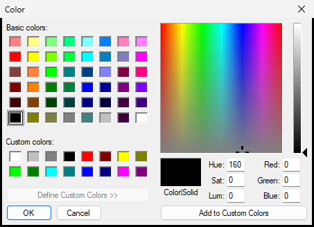

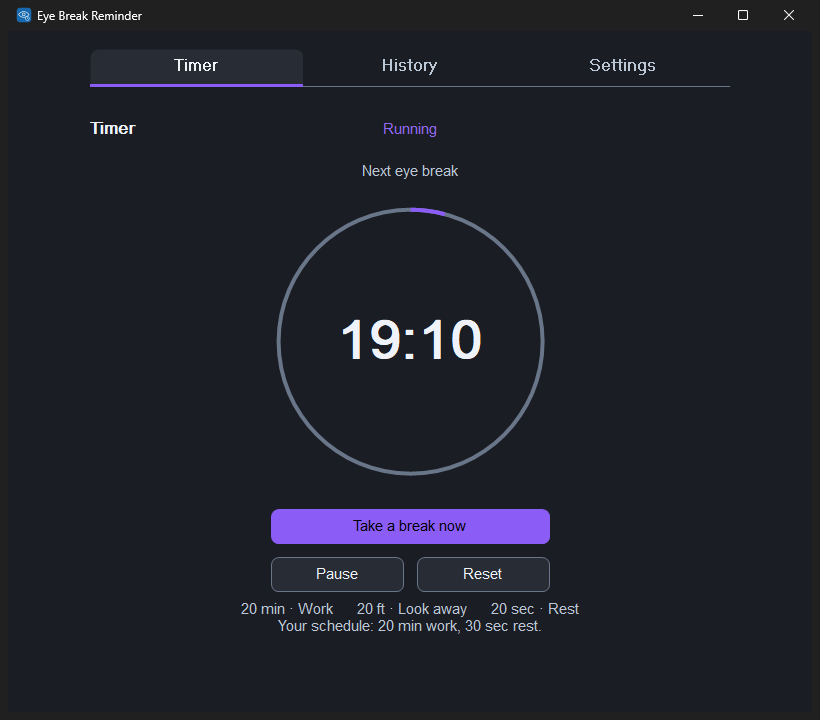

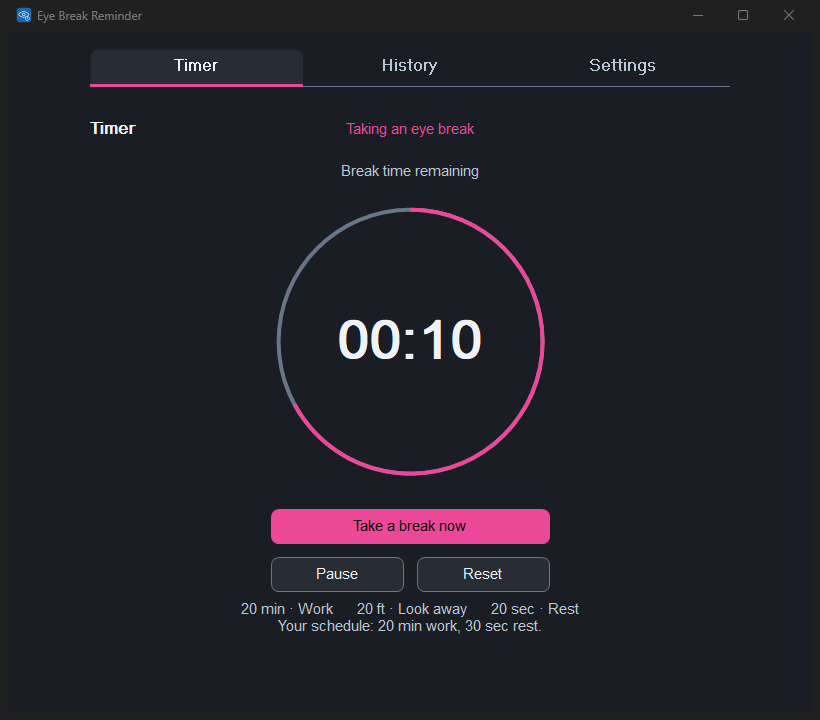

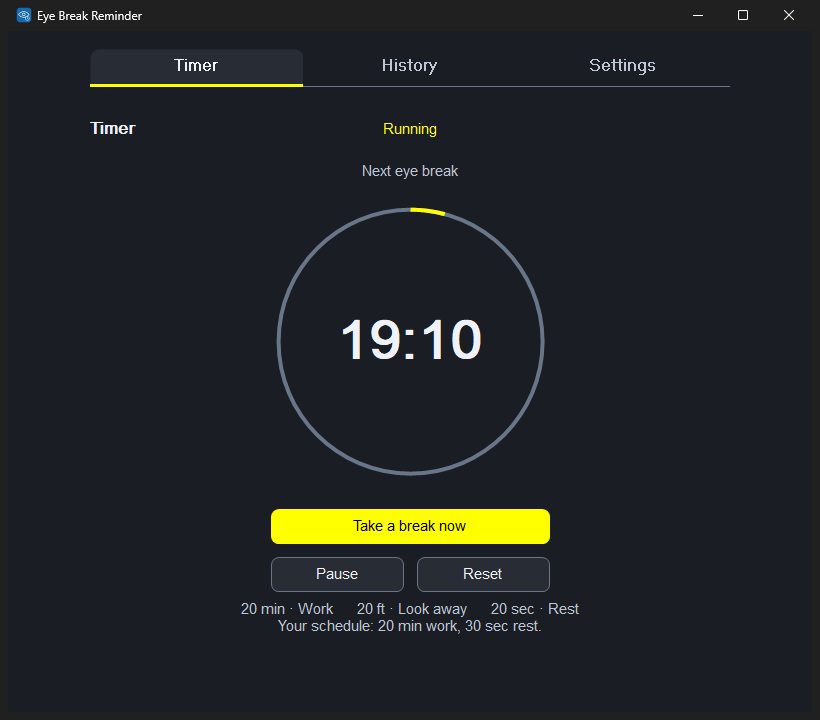

### Accessibility and installed reminder

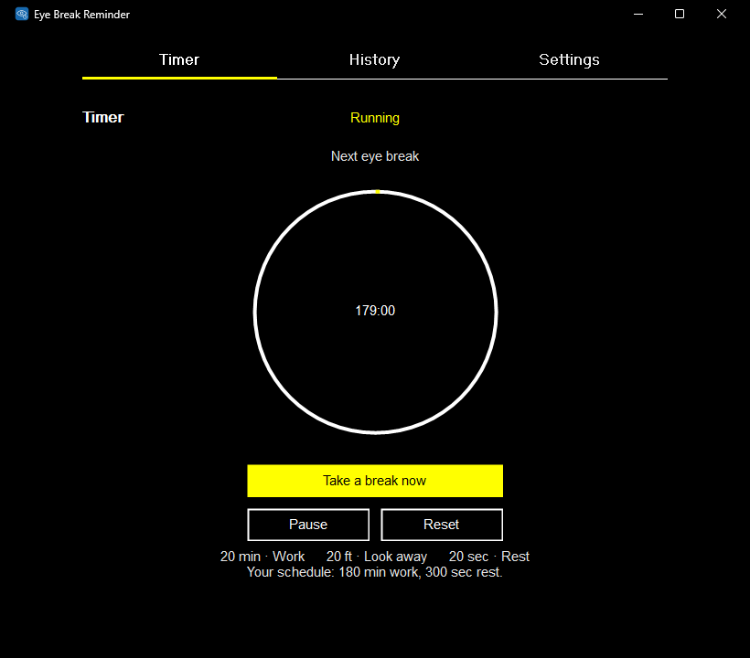

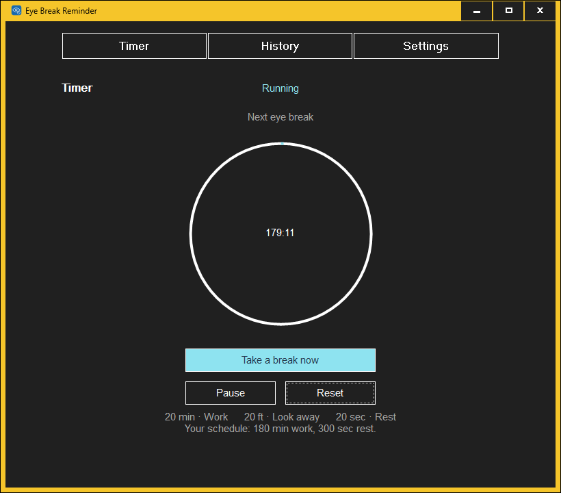

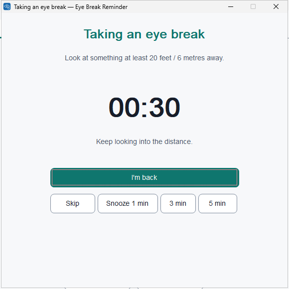

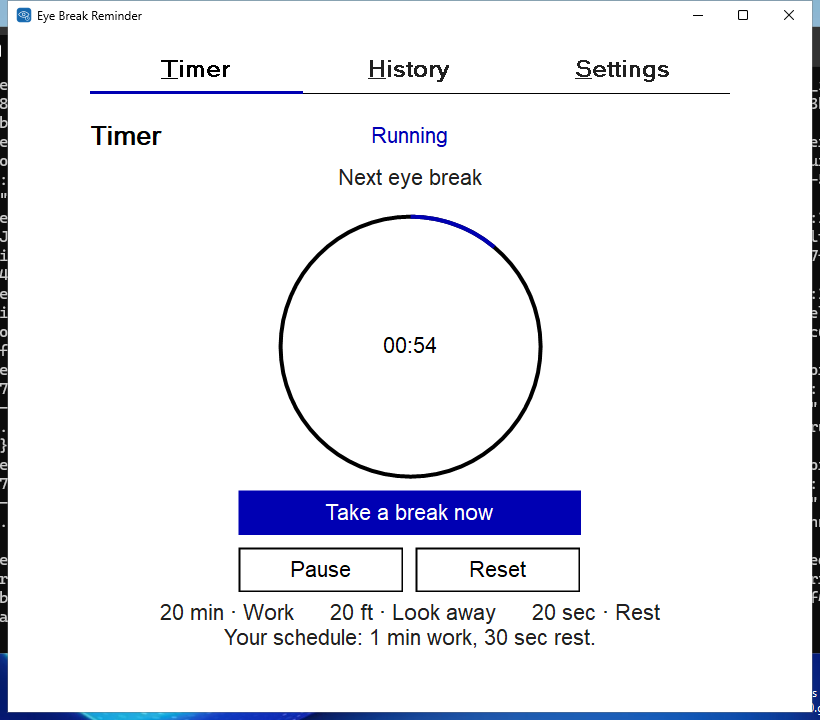

### Installer upgrade and soak evidence

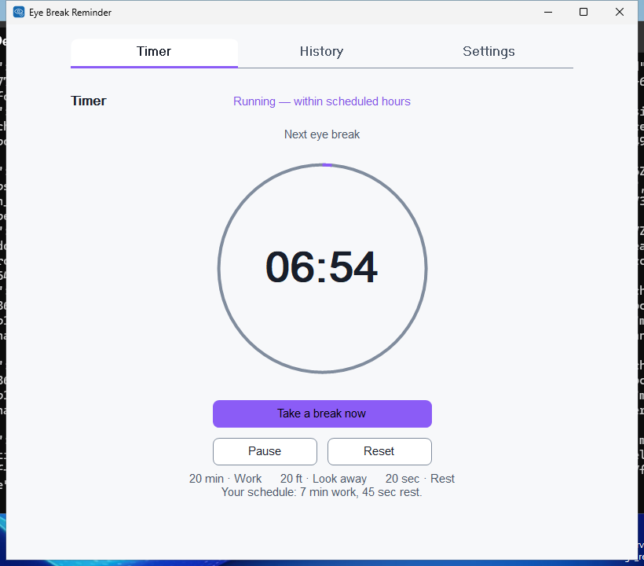

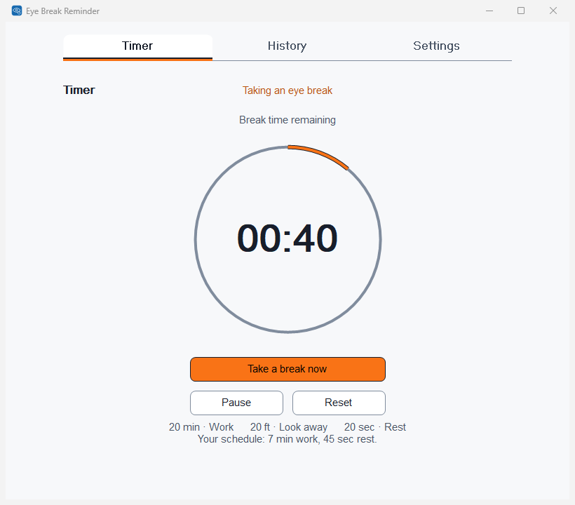

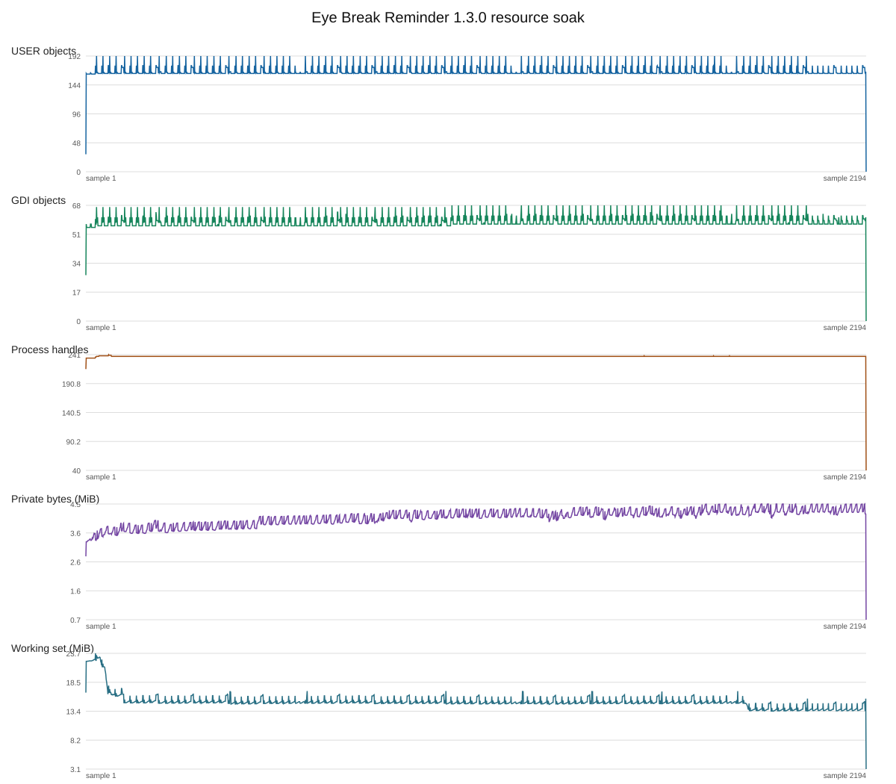

Raw evidence: [GUI results](evidence/v1.3.0-final-pre-release/gui-acceptance-results.json), [installed and upgrade results](evidence/v1.3.0-final-pre-release/windows-pre-release-results.json), [soak summary](evidence/v1.3.0-final-pre-release/soak-summary.json), [cycle CSV](evidence/v1.3.0-final-pre-release/cycle-results.csv), [resource time series CSV](evidence/v1.3.0-final-pre-release/resource-time-series.csv), [runner capabilities](evidence/v1.3.0-final-pre-release/runner-capabilities.json), and [hosted build artifact identities](evidence/v1.3.0-final-pre-release/release-artifact-identities.json).

## NOT TESTED and limits

The hosted installed-app results recorded 13 NOT TESTED items:

1. Narrator/screen-reader speech was not started.
2. The TaskDialog close-to-tray instruction text was not exposed to `GetWindowText` (the dialog was visible and captured).
3. A separate Windows Shell notification surface was not observed.
4. Production audio and physical speaker output could not be verified on hosted hardware.
5. The candidate NSIS finish-page Run checkbox state was not exposed.
6. The fresh candidate uninstall UI process exit code was unavailable.
7. The v1.1.0 comparison uninstall finish-page Run checkbox state was not exposed.
8. The v1.1.0 comparison uninstall UI process exit code was unavailable.
9. A real timer tick did not overlap the live network response in that particular run; the delayed-response GUI test covered the overlap path.
10. Physical workstation lock/unlock was not performed.
11. Physical sleep/resume was not performed.
12. Multiple-monitor behavior was unavailable because the runner had one monitor.
13. Physical speaker output was not available (same hosted-hardware limit as item 4).

Two additional requested lifecycle scenarios were not exercised by this harness: restarting specifically during an active Break, and rebooting Windows. The soak did restart the app while Work was active. The hosted VM was not rebooted. These are not product failures, but remain test limits.

## Candidate artifacts

The completed hosted Windows build produced all five v1.3.0 files and passed package checks. Its exact identities are:

| File | Bytes | SHA-256 |
|---|---:|---|
| `EyeBreakReminder.exe` | 2,652,672 | `47b17d031580a6ad90c322715f50691a448d58738fe9dcdfc8388d23f0bad624` |
| `EyeBreakReminder-Setup-x64.exe` | 1,316,456 | `2a2bbb0c83dc631b76301ad5ee2220bf7740bc73a79e7cf52068ed67838d9c48` |
| `EyeBreakReminder-Portable-x64.zip` | 1,470,519 | `fc783763d0261c0b881481363217a52079dbcd8ca2830a88da176e8ce17ebfeb` |
| `EyeBreakReminder-Source.zip` | 2,261,021 | `9fd0c1609195430c006ee3543712c9883cb358206286bd04010d24993b988151` |
| `EyeBreakReminder-SHA256.txt` | 382 | `d6db54bcf4b5cea61f2afcb53f360e75c3671f12f7c2fcc61e1c817a6a11b2d` |

The completed worktree also contains a locally prepared set in `release/`. `make package` regenerated the portable/source archives and SHA-256 manifest and passed 6,700 core assertions plus 105 local binary/package assertions. The local verifier confirmed x64 Windows GUI metadata, the `comdlg32` ChooseColorW link, five embedded sounds and nine icon sizes.

| Local file | Bytes | SHA-256 |
|---|---:|---|
| `release/EyeBreakReminder.exe` | 2,610,176 | `07661757898c2da4268bf141075aecd5b5f2a1c102c7de04e974928e9f0b8443` |
| `release/EyeBreakReminder-Setup-x64.exe` | 1,409,032 | `cf529d75f3b56652bb1e829e88fa3f27d4730664e2d7753f3511046c4fbee2a6` |
| `release/EyeBreakReminder-Portable-x64.zip` | 1,453,917 | `230908b6d79c862fcd6e9032d364cd30c13855a94e57982f3a67da6682bf2482` |
| `release/EyeBreakReminder-Source.zip` | 2,811,271 | `f971cae456406abb0303c41e10d48706964af9f83602a22883afbaae74217dcd` |
| `release/EyeBreakReminder-SHA256.txt` | 382 | `a5b8af6155005e0645de5a1ac0ddc10d04ecbce1e41f5168a6907af502081d50` |

The local executable/installer hashes do not match the five hashes from the successful hosted build. The hosted workflow intentionally did not upload release binaries, so those exact hosted files cannot be recovered from its evidence artifact. The local set is available for inspection, but it is not represented as the same binary build that passed hosted installer and GUI acceptance. This provenance difference is a publication gate. The source archive excludes this report to avoid a self-referential digest.

## Final status

- Product defects found in this validation: **none**.
- v1.2.1 release/tag/assets: unchanged; the existing tag still targets `ab4b772550a9f3b67d5abcee979f3d0e6e1e8701`.
- Exercise Break Reminder: untouched.
- v1.3.0: not published, not tagged, and not merged.
- Publication recommendation: **not ready yet**. There are no product failures, but the local release binaries do not match the exact hosted build hashes. A single artifact set must be correlated with the acceptance-tested build before publication approval.
