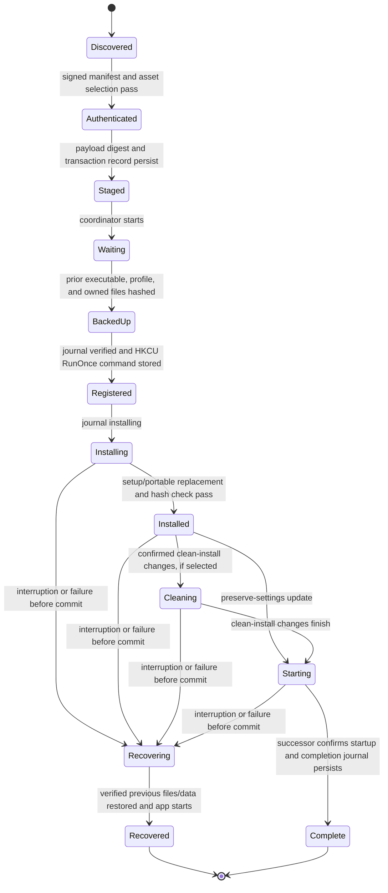

# v1.4.0 restart recovery and RunOnce verification

## Current result

**FAIL-024 and ENV-005 remain BLOCKED.** The original acceptance criteria require a genuine Windows restart/sign-in and recovery; no such event occurred. Focused hosted workflows and independent raw-report reviews provide supplemental process-recovery and exact-command evidence only. The latest repeat run [45582725295](https://github.com/REMEDIOSSAMUEL/EYE-BREAK-REMINDER/actions/runs/45582725295) completed on GitHub-hosted Windows Server 2025 x64 and explicitly records `GenuineWindowsReboot=false` and `WindowsSignInInvocation=false`. No authorized persistent Windows 11 guest or licensed installation media is available, and the personal laptop was not used. The acceptance matrix remains 224 PASS / 0 FAIL / 1 NOT TESTED / 7 BLOCKED / 2 NOT APPLICABLE.

The focused source review identified recovery correctness issues and targeted source/test changes. The exact historical production candidate remains preserved as artifact [14695418078](https://github.com/REMEDIOSSAMUEL/EYE-BREAK-REMINDER/actions/runs/44875679345/artifacts/14695418078), with application SHA-256 `07f6c1eaee5818df9f5c024310883ca94b8274a4f451186a8123974fb5e5f720`, setup SHA-256 `a15fc525557603dbed1ef0dccb8d128e500dfee91c6416b478513de790dd5c9b`, and candidate source `491bd2ed29f84f4d434b884fc723144db2d6f294`. It does not contain the recovery source changes. Replacement candidate run [45575765880](https://github.com/REMEDIOSSAMUEL/EYE-BREAK-REMINDER/actions/runs/45575765880) completed successfully at candidate source commit `0f49949a9e753fcca390c25affc99d7698b1ecde`; unsigned input artifact [15005217160](https://github.com/REMEDIOSSAMUEL/EYE-BREAK-REMINDER/actions/runs/45575765880/artifacts/15005217160) contains the five verified release files. Its EXE SHA-256 is `3dd3fa4c8e9f6200780c7bf0c2340435c7b127ce6b6202b24857105f01f3719a`; the run passed its candidate gates and reused the matching 110-cycle soak from run `45499840097`. After signing, finalizer run [45582714164](https://github.com/REMEDIOSSAMUEL/EYE-BREAK-REMINDER/actions/runs/45582714164) completed three jobs and 36 steps with zero skips. It retained the final seven-file candidate [15007651099](https://github.com/REMEDIOSSAMUEL/EYE-BREAK-REMINDER/actions/runs/45582714164/artifacts/15007651099), clean-download verification artifact `15007920934`, and signed transaction artifact `15007776608`. The transaction passed 21 assertions on an isolated Windows runner. The signed metadata uses key `p256-0aff97759ea95258`, manifest SHA-256 `88ec256d6c4bb8f0c52946b947cf8778e0966f8cfe84c9f83c551f9a61af84a6`, and raw 64-byte signature SHA-256 `c0906144d52623a4d428df0d69208a849102df731877bbcdb9d366d1f4031992`. The exact candidate is signed and independently verified; it is not the historical artifact 14695418078. Standard-user installation/uninstallation and updater/portable transactions passed. The optional Settings Apps route remained NOT TESTED, so UN-009 has not been satisfied.

### Latest repeat-run recovery evidence — 2026-11-25

Recovery workflow [45582725295](https://github.com/REMEDIOSSAMUEL/EYE-BREAK-REMINDER/actions/runs/45582725295) completed successfully at PR head `61a9d4732ae757f9e2cd0c2fd408140fe69db163`; it executed synthetic merge commit `36e9cbca4046ea5bd3ce7efb2be87c45ec38f792`. It used the historical production candidate artifact `14695418078` as its installed baseline, plus disposable recovery/update fixtures signed with an ephemeral test key. It does not constitute recovery testing of the new candidate artifact `15007651099`.

The Short artifact [15007236708](https://github.com/REMEDIOSSAMUEL/EYE-BREAK-REMINDER/actions/runs/45582725295/artifacts/15007236708) and Long artifact [15007291642](https://github.com/REMEDIOSSAMUEL/EYE-BREAK-REMINDER/actions/runs/45582725295/artifacts/15007291642) contain the repeat reports. Short interruption/recovery reports passed 17/17 and 43/43 assertions; their SHA-256 values are `b4ac855382738aba77e1d3d9a3f35ef0dc9aa07b2bb8efb26ea73346c3fe72b7` and `42a6b6f363053d76156e4ff7ca9c0c707211885b1ecce2b07fa35d2cdf65dbc2`. Long interruption/recovery reports passed 17/17 and 45/45; their SHA-256 values are `99c527180cc9f94743d5baf56c6f7b619a6630570e3ce9e90e72c0dc14259ce0` and `fde3e05ec155e3b0bd4634235321340cdfe9f9f964bb3d446070eb6a39c4ad22`.

The reports recorded a 240-character Short RunOnce command. In the Long layout, the full explicit command was 336 characters and exceeded the documented 260-character limit; the exact registered compact command was 176 characters.

The rerun repeated process termination, loss of original helper/harness memory, locked owned-file partial restoration, replay of the actual captured HKCU RunOnce command in a fresh process, retry, and final settings/history/timer checks. The harness only modeled the `!` value's post-command deletion; it did not observe Windows dispatch. This repeats prior covered scenarios and does not add unique recovery cases or official acceptance PASS rows. It does not reproduce Windows shutdown ordering, a real sign-in, automatic RunOnce invocation, OS crash, or physical power loss.

An independent evidence review recomputed all four raw report hashes and confirmed the 17/43 Short and 17/45 Long assertion totals, correct artifact and historical-baseline identities, same boot/user session within each layout, distinct recovery processes, false reboot/sign-in flags, and manual exact-command replay. The reviewer also confirmed these repeats duplicate prior scenarios and cannot change FAIL-024 or ENV-005 from BLOCKED.

## Original acceptance criteria

The acceptance matrix defines:

| ID | Original criterion | Required evidence | Current classification |
|---|---|---|---|
| FAIL-024 | Recover after an interrupted transaction across an actual operating-system restart. | Genuine reboot, sign-in, and RunOnce recovery. | BLOCKED |
| ENV-005 | Genuine reboot and sign-in RunOnce recovery. | Actual reboot, sign-in, and RunOnce evidence. | BLOCKED |

The matrix entries remain unchanged in meaning. Manually starting the exact registered command, process termination, or loss of the original harness process cannot satisfy the actual reboot/sign-in requirement.

## Environment availability

The owner has no licensed Windows 11 x64 installation media or existing isolated Windows desktop. A read-only GitHub Actions runner inventory returned no self-hosted runners. No QEMU executable or active QEMU process was found. The personal host is not a test guest and was not used for application, Registry, restart, or sign-in testing.

At 2026-11-24 21:08 UTC, read-only host measurements reported 15.73 GiB total RAM, 2.91 GiB available, an Intel Core i5-1135G7 with 8 logical processors, mean CPU use of 50.7% across three one-second samples, and 379.8 GiB free on C:. The proposed 4 GiB guest RAM exceeds current available memory, so the guest resource gate is closed. No guest was created or launched.

## First hosted execution and corrective action

At source/test head `f2c2448c08c2e4fa8a62af4ba066c7ca6cd9e296`, PR validation [45488891232](https://github.com/REMEDIOSSAMUEL/EYE-BREAK-REMINDER/actions/runs/45488891232) passed. The update-security run [45488892400](https://github.com/REMEDIOSSAMUEL/EYE-BREAK-REMINDER/actions/runs/45488892400) and both Short/Long jobs in focused recovery run [45488892765](https://github.com/REMEDIOSSAMUEL/EYE-BREAK-REMINDER/actions/runs/45488892765) reached the Windows regression executable, which observed SEC-028 rejection of all 25/25 cases with zero helper launches. Both workflows then failed the test fixture's final directory removal (`ERROR_DIR_NOT_EMPTY`, code 145): the newly written `validation-profile/transaction-state.ini` had not been deleted. Consequently, the dedicated recovery harness's later candidate fixture, process interruption, and recovery/replay steps were skipped. Those runs are not recovery passes and did not reveal an application recovery failure.

The isolated correction in [updater_windows_tests.cpp](../tests/updater_windows_tests.cpp) deletes that exact journal only when disposable staging was successfully created, guards the truncated-journal write, and keeps all stage cleanup under the created test stage. This also prevents an empty failed-stage path from becoming a drive-root write/delete target. Independent safety review confirmed the guard. Strict MinGW C++17 syntax checking passed with the Windows Unicode and Windows 10 API defines; `git diff --check` passed. Commit `e9f56c3da27739811c922b1b80ff2082cc8aabaa` contains only this test-harness correction. It does not change production source or the retained candidate.

The corrected PR validation [45491699125](https://github.com/REMEDIOSSAMUEL/EYE-BREAK-REMINDER/actions/runs/45491699125) passed. At the next source revisions, focused recovery run [45491699115](https://github.com/REMEDIOSSAMUEL/EYE-BREAK-REMINDER/actions/runs/45491699115) exposed a genuine source cleanup-handoff race: the app could signal startup before the detached cleanup worker had acquired and validated the helper process handle. Source commit `e2ca0d5f259aeb23e8665d22f7b35ae0063fea48` moved the handle validation and waiter creation before startup confirmation. The same run's bounded DNS warm-up also ended at a one-time two-handle initialization; the resource measurement now requires 16 equal transitions after a minimum 128 samples, up to 160, before the existing strict stable tail. The run itself is not a passing recovery result.

## Final hosted process-recovery and security results — 2026-11-24

At source/test head `e2ca0d5f259aeb23e8665d22f7b35ae0063fea48`, focused recovery workflow [45494673431](https://github.com/REMEDIOSSAMUEL/EYE-BREAK-REMINDER/actions/runs/45494673431), update-security workflow [45494673518](https://github.com/REMEDIOSSAMUEL/EYE-BREAK-REMINDER/actions/runs/45494673518), and PR validation [45494673452](https://github.com/REMEDIOSSAMUEL/EYE-BREAK-REMINDER/actions/runs/45494673452) all reached terminal success. The raw recovery reports are artifacts [14968257225](https://github.com/REMEDIOSSAMUEL/EYE-BREAK-REMINDER/actions/runs/45494673431/artifacts/14968257225) and [14968575694](https://github.com/REMEDIOSSAMUEL/EYE-BREAK-REMINDER/actions/runs/45494673431/artifacts/14968575694); the security report is artifact [14968272800](https://github.com/REMEDIOSSAMUEL/EYE-BREAK-REMINDER/actions/runs/45494673518/artifacts/14968272800). The independent safety/evidence reviewer checked the raw JSON and workflow outcomes, exact candidate identities, interruption triggers, process termination scope, registry evidence, hashes, user data, and final states.

| Layout | Interruption assertions | Recovery assertions | Evidence summary |
|---|---:|---:|---|
| Short path | 17/17 | 43/43 | Exact registered command, settings/history and installed files restored, helper failure/retry, timer advanced. |
| Unicode/long path | 17/17 | 45/45 | Same, including the compact registered command when the full quoted command exceeds 260 characters. |

There are **122 unique recovery assertions** across the two layouts; assertions copied into nested report fields are counted once. In each layout, the test confirmed the intended `cleaning` transaction state, exact disposable coordinator identity and termination, fresh PowerShell recovery process, persisted journal/backup/signature data, and the actual `HKCU\Software\Microsoft\Windows\CurrentVersion\RunOnce` value created by the real coordinator. The first recovery was blocked on a disposable locked `Uninstall.exe`; the test verified that the executable restoration had occurred while later file/data groups and transaction state remained available, then released the lock and replayed the captured command. It also exercised a later helper interruption and retry, verified byte-identical settings/history and registrations, and observed timer progression. Short path terminated both helper and restored app before retry; long path kept the restored app alive while terminating only the helper.

The exact registered command was manually executed in a new process and different working directory. Both layouts left the `!EyeBreakReminderUpdateRecovery` value in place while that command ran; the disposable harness then removed only that exact value to model Windows post-command deletion and verify cleanup. The harness did not fabricate or modify the command before invocation. The recovery helper did not need in-memory state from the original updater or harness. This proves command validity and process recovery, **not** automatic Windows invocation at sign-in.

The recovery workflow used GitHub-hosted Windows Server 2025 Datacenter x64 build 26100, not Windows 11. Each job stayed in one boot and one user/session. The production installer and baseline executable were identified against candidate artifact 14695418078; the update/recovery coordinator was a test build signed with an ephemeral test key. The recovery binary's test-build baseline SHA-256 was `a090aa489ea686d23b8e9447516e6e0264c83c328bff19b88f76867b6d34f4e9`. The fixture successor was also test-only. No malicious fixture used the production key. The final source commit is `e2ca0d5f259aeb23e8665d22f7b35ae0063fea48`; candidate source, tested source, and workflow run identities are separate.

Raw report SHA-256 values independently recorded by the evidence reviewer:

- Short interruption report: `7d8b065077c688c32561ea6787308afe485853f16f51563da5800d7814b269c8`.
- Short recovery report: `51d4e37b3a38b3bbc7b2f6bfa78458b2badade3b1aa88b07920b896ba62af9aa`.
- Long interruption report: `e86b475ea20be1b871b5254551a06e8f2552fa771b603a5a9a6fdd37bc2f584e`.
- Long recovery report: `46766a1173f55687db3f0cc38d4187535f96300b52c5fe66d1ca4be97ae30d33`.

The same run passed 181 updater assertions, SEC-028's 25/25 rejection cases with zero helper launches, and 76 portable recovery integration assertions per layout (PORT-008/009/010). Update-security run 45494673518 passed 11 CNG checks, 14 real DNS failure/retry checks, 25/25 SEC-028 cases, 181 updater assertions, and 70 exact-production-candidate transaction assertions: portable 21, installed clean/history-retain 24, and clean/explicit-history-delete 25. Its DNS handle count stabilized at 208 after the 128-request active warm-up and remained stable through 20 resolver failures. The candidate executable SHA-256 matched `07f6c1eaee5818df9f5c024310883ca94b8274a4f451186a8123974fb5e5f720`; production key ID `p256-0aff97759ea95258` was used for legitimate candidate transactions, while a test key was rejected. These security and transaction assertions are not additional acceptance matrix rows.

The independent reviewer counted no accepted full-requirement PASS. `GenuineWindowsReboot=false` and `WindowsSignInInvocation=false`; timestamps, boot identity, user, session, and process lineage confirm no reboot or sign-in transition took place. The original FAIL-024 and ENV-005 classifications therefore remain BLOCKED.

The separate updater resource-loop run [45488873580](https://github.com/REMEDIOSSAMUEL/EYE-BREAK-REMINDER/actions/runs/45488873580) passed on a test-build executable and retained artifact [14964997953](https://github.com/REMEDIOSSAMUEL/EYE-BREAK-REMINDER/actions/runs/45488873580/artifacts/14964997953). Its report records eight repetitions each of update-check failure, download cancellation, hash rejection, and coordinator rejection; stable handle/GDI/user-object counts; an unchanged isolated profile sentinel; and `HostRestarted=false`. This resource check is supplemental and does not exercise interrupted-update recovery, RunOnce, reboot, or sign-in.

## Repeat-run confirmation of partial-restore and repeated-interruption evidence — 2026-11-24

Recovery workflow [45505498346](https://github.com/REMEDIOSSAMUEL/EYE-BREAK-REMINDER/actions/runs/45505498346) completed successfully on a GitHub-hosted Windows Server 2025 Datacenter x64 build 26100 runner. The PR head was `0f49949a9e753fcca390c25affc99d7698b1ecde`; the workflow executed synthetic merge commit `34bd4ef6c8c3e2f7fce51bc164fbc6c902732544`. The workflow report binds the test to the historical candidate artifact `14695418078`, setup SHA-256 `a15fc525557603dbed1ef0dccb8d128e500dfee91c6416b478513de790dd5c9b`, and candidate EXE SHA-256 `07f6c1eaee5818df9f5c024310883ca94b8274a4f451186a8123974fb5e5f720`. The recovery workflow and recovery-test source were unchanged from earlier recovery run `45494673431`; this is a repeat execution for branch-head evidence, not a new unique interruption scenario. The recovery/update fixtures used an ephemeral test key and isolated test build; this is supplemental recovery evidence, not a replacement-candidate acceptance result.

The Short and Long report artifacts are [14973592847](https://github.com/REMEDIOSSAMUEL/EYE-BREAK-REMINDER/actions/runs/45505498346/artifacts/14973592847) and [14973323802](https://github.com/REMEDIOSSAMUEL/EYE-BREAK-REMINDER/actions/runs/45505498346/artifacts/14973323802). Their recovered JSON SHA-256 values are respectively `01fb10e4b33c6a8269b6c157e80f55cc7ee1b9d2a2c1d691d4592fe84cdb8c93` and `e3b53a2406786e7e614b863536c8e565fb2a87f5bf8cc6536d40a976f974d78b`. Each recovery report passed all of its assertions (Short 43/43, Long 45/45); these are per-run assertion totals and are not added to the earlier 122-unique count because many assertions overlap.

The rerun reproduced the existing locked owned `Uninstall.exe` backup-target test. It verified that the old executable had been restored, the later owned-file/data restoration had not been falsely reported complete, the incomplete transaction and exact `HKCU\Software\Microsoft\Windows\CurrentVersion\RunOnce` command remained available, and a scoped `Eye Break Reminder Recovery` error was shown. It then terminated only the exact failed disposable recovery helper (Short PID 1920, Long PID 3600; exit code -1), released the lock, and retried the captured command. The actual RunOnce command succeeded in a fresh process without any OS restart. The reports explicitly record `GenuineWindowsReboot=false` and `WindowsSignInInvocation=false`.

The same existing scenario re-exercised interruption during recovery after partial restoration. The Short scenario terminated both the recovery helper and the already-restored application before retry; the Long scenario terminated the recovery helper while leaving the restored application running. Both subsequently converged to the previous version, restored byte-identified settings and history (including history that the interrupted Clean Install had explicitly deleted), restored installed/startup registrations, and idempotently completed cleanup. These results reconfirm the existing locked-target failure, helper termination, loss of original harness/process memory, partial rollback retry, and convergence with or without the restored app still running; they are not counted as new unique scenarios or official acceptance rows. They still do not reproduce Windows shutdown ordering, automatic sign-in invocation, abrupt OS failure, or physical storage power loss.

## Update transaction architecture

The implementation in `src/update_coordinator.hpp`, `src/update_client.hpp`, `src/update_manifest.hpp`, `src/update_signature_win.hpp`, and the `--update-recover` dispatch in `src/app.cpp` has these stages:

| Stage | Persisted state and changes | Recovery consequence |
|---|---|---|
| Discover and authenticate | The updater discovers release metadata, verifies the publisher signature, and selects a role-specific installer or portable asset. | No installed file or user data has changed. |
| Download and stage | Payload and manifest/signature are kept under the current user's Eye Break Reminder `updates` directory. Size, digest, role, version, path, and signature are checked. | An incomplete download is not executed. A validated transaction still has not replaced the installed executable. |
| Record waiting and create backups | A journal phase is written. After the old app exits, the coordinator backs up the previous executable, the existing settings/timer/history files, and installed owned files. SHA-256 values and masks are written into `transaction.ini`. | Backup or metadata failure aborts before the installer or portable replacement is run. |
| Register recovery | The journal advances to `verified`, the current user's `HKCU\Software\Microsoft\Windows\CurrentVersion\RunOnce` receives `!EyeBreakReminderUpdateRecovery`, then the journal advances to `installing`. | There is a persistent recovery command before application replacement begins, subject to Windows RunOnce processing and Registry persistence. |
| Replace application | Installed updates launch the verified NSIS package. Portable updates copy to an adjacent temporary file, verify it, and replace the executable. The coordinator checks installed version and SHA-256. | `installing`, `installed`, or later journal phases trigger rollback if recovery is invoked. |
| Apply clean-install choice | For a confirmed Clean Install, the journal is set to `cleaning` before settings/timer and optional history deletion and startup-registration changes. | The saved files allow rollback to restore the pre-update state, including history the owner explicitly selected for deletion if this update later fails. |
| Start successor and commit | The journal becomes `starting`; the successor must signal startup confirmation. Only after confirmation is `complete` written and the RunOnce value cleared. | Before `complete`, recovery rolls back. `complete` is treated as committed and is not downgraded. |
| Recover and clean | The helper validates the transaction and publisher-signed manifest, restores the prior executable/files/data for an interrupted destructive phase, writes `recovered`, and starts the prior app. The recovery helper leaves its `!RunOnce` value to Windows; after the command finishes, the app removes stage files only after the registration disappears and the committed/recovered state and running executable validate. | Recovery can be re-entered from persisted transaction and journal data without the original coordinator's memory. |

The state diagram describes implemented journal phases; it does not imply that each transition has been forcibly interrupted in a test. The evidence boundary checklist below distinguishes previously verified behavior from this new focused run and work still pending.

| Boundary / condition | Existing evidence | Focused workflow | Still unverified |
|---|---|---|---|
| Before transaction persistence | Source ordering shows no files change before the transaction record is written. | Not fault-injected. | Process kill during initial transaction write. |
| Backup failure / incomplete backup | Hosted backup-failure and corrupted-backup artifacts listed below. | Backup bytes are rehashed before interruption. | Forced termination during each individual `CopyFileW`. |
| After recovery registration and destructive clean-install changes | Historical candidate transaction evidence exists. | Kills the exact coordinator at persisted `cleaning`, after confirming the successor and deleted selected data. | A real OS restart and automatic RunOnce dispatch. |
| Recovery interrupted between file groups | Historical locked-file evidence covers update replacement, not this rollback boundary. | In both hosted path layouts, holds the disposable installed `Uninstall.exe` open; verifies the previous app executable has been restored while the owned-file group, clean-deleted user files, version registration, journal, and RunOnce remain recoverable; kills only the exact blocked recovery helper, releases the lock, then replays the captured command successfully. | Abrupt termination inside an individual atomic `MoveFileExW` call; power-loss behavior. |
| Recovery helper interrupted after file/data restore | Earlier recovery evidence is listed below. | Suppresses only the test successor's confirmation, observes `recovered`, then tests both all-process loss and a surviving restored app across retry. | Abrupt OS crash or interruption at each individual rename/Registry write. |
| Corrupt/truncated journal | Source parser and focused regression reject incomplete state. | Native regression step includes the assertion. | Physical power-loss/torn-sector behavior. |
| Recovery command mismatch / stale transaction | Source rejects a foreign RunOnce owner before destructive rollback; missing registration requires explicit manual confirmation. | Pure command-identity regression accepts only the current/legacy transaction command and rejects a foreign command. The hosted run asserts the actual stored command. | End-to-end mismatched Registry value with unchanged live files; real Windows sign-in behavior; hostile same-user code. |
| Settings/history and registrations | Prior exact-candidate transaction tests cover preserve and clean choices. | Verifies byte-identical settings/history restoration, startup preference, uninstall registration, unrelated sentinel, and timer advance after rollback. | Every supported option combination under a real reboot. |

The rollback is restartable, but it is **not one atomic operation across the executable, installer-owned files, user files, registry values, and journal**. It restores the application executable first, then the installed owned-file group, then the settings/history group and registrations. Each file group is prepared and verified before that group's replacements. If validation or replacement fails in a later group, earlier groups may already have been restored; backups and journal must remain for another recovery attempt. The implementation does not promise that all live files remain untouched after every recovery error.

## Persistent state, backups, and durability

`transaction.ini` records fixed paths, package kind/name, prior and successor versions, nonce, expected hashes and size, settings policy, process identity, backup masks, and backup digests. The parser rejects missing/duplicate/unknown fields, invalid values, malformed digests, and paths outside the user's application/update directories. `transaction-state.ini` records the current phase.

Both transaction and journal writers use unique temporary files, flush calls, and replace/move operations. The transaction and journal writers use `FlushFileBuffers` before `MoveFileExW(..., MOVEFILE_REPLACE_EXISTING | MOVEFILE_WRITE_THROUGH)`. The journal reader now rejects reparse-point, truncated, extra-field, mismatched-version, and unknown-phase records. This is stronger than observing data in the same process, but it is not evidence that a real machine survived power loss.

Backup files are copied and immediately reread/hashed against the originals before their hashes and masks are written to the transaction file. `CopyFileW` is not followed by an explicit `FlushFileBuffers` on each backup. The hashes establish byte agreement observed by the running system; they do not prove that backup data has reached persistent physical media. The Registry command is written with `RegSetValueExW`; the application does not call `RegFlushKey`. No physical power interruption or unexpected host storage loss has been tested.

The backup hashes and the journal share the user's profile ACL. They detect truncation or accidental corruption, but are not an authentication boundary against code already running as that same user. The publisher signature authenticates the update manifest and payload identity. Recovery does not execute the staged successor payload.

Microsoft documents that `FlushFileBuffers` requests buffered file data be written to the device and that `MOVEFILE_WRITE_THROUGH` waits for the move; these API contracts do not turn process-termination tests into a physical power-loss test. See [FlushFileBuffers](https://learn.microsoft.com/en-us/windows/win32/api/fileapi/nf-fileapi-flushfilebuffers), [MoveFileExW](https://learn.microsoft.com/en-us/windows/win32/api/winbase/nf-winbase-movefileexw), and [Flushing system-buffered I/O data to disk](https://learn.microsoft.com/en-us/windows/win32/fileio/flushing-system-buffered-i-o-data-to-disk).

## RunOnce implementation and Windows semantics

The updater registers a per-user `REG_SZ` value named `!EyeBreakReminderUpdateRecovery` below `HKCU\Software\Microsoft\Windows\CurrentVersion\RunOnce`. The value is a quoted staged `coordinator.exe` path and `--update-recover`, plus the quoted `transaction.ini` path when the full command fits. If the explicit form would exceed Microsoft's 260-character documented command-line limit, the command omits the transaction argument; `wWinMain` then derives `transaction.ini` beside the actual running coordinator. It rejects a compact command that still exceeds the bound.

The recovery entry is per-user. It runs, if Windows processes the entry, in that user's logon context; no machine-wide `HKLM` entry or administrator-only installer service is used. The exact command path and transaction are validated before rollback. A valid manifest signature is still required, and recovery only restores the previous executable/data; it never runs the downloaded successor. Staging and profile paths are constrained; installed targets are tied to the registered install directory. A portable target must have the fixed executable filename, a safe non-reparse parent, and must not masquerade as the registered installation, but its original path is not independently signed. A same-user-modified transaction could redirect it to another writable executable path; this is within the same-user tampering boundary and remains a destructive-scope limitation.

Microsoft's current [Run and RunOnce documentation](https://learn.microsoft.com/en-us/windows/win32/setupapi/run-and-runonce-registry-keys), checked 2026-11-25 and last updated 2026-02-21, says `!` defers RunOnce value deletion until after its command runs. It does **not** promise retries after an unsuccessful command. It also advises a command launched from Run/RunOnce not to write those keys while executing. The page documents a 260-character command-line limit; the implementation uses the bounded compact command when needed. RunOnce entries are normally ignored in Safe Mode unless the value name has a `*` prefix. HKLM RunOnce is limited to Administrators logging on after a reboot; this app instead registers in HKCU. Safe Mode and automatic Windows sign-in invocation remain untested. The recovery helper leaves its RunOnce value untouched on both success and failure and lets Windows perform the documented post-command deletion. A normal updater coordinator may remove its own value because it is not the RunOnce recovery command. If a manually launched command has no matching registration, it asks for explicit confirmation before rollback. The error message does not promise an automatic retry; it preserves backups and directs the user to support/manual recovery.

Microsoft's separate [standard-user RunOnce article](https://learn.microsoft.com/en-us/troubleshoot/windows-client/shell-experience/standard-user-cannot-run-commnad-via-runonce) lists HKCU RunOnce and says standard-user commands are suppressed, but its explicit applicability field says Windows 10 all editions. It does not settle Windows 11 behavior for this app. Windows 11 standard-user and administrator/split-token automatic sign-in behavior remain unverified and must be tested in a real authorized guest before either acceptance row can pass.

No test modifies a RunOnce value in the owner's personal profile. The focused hosted harness reads the genuine value created by the real coordinator and manually starts the exact command string. That is command-validity evidence only.

## Recovery security and cleanup

Recovery validates:

- The transaction file format, allowed transaction phase, and per-user stage, target, and data paths.
- The coordinator's actual executable path against the path derived from the registered stage.
- The signed manifest, release/version relationship, selected asset, and payload digest binding.
- Backup masks/digest syntax and each backup's digest before restoration.
- The previous executable's version and digest before it is installed or started.
- The process/window image path before asking an app instance to exit.
- A coordinator mutex before reading transaction/journal state or starting recovery.
- A newer installed version against stale transaction state before rollback.

The application cleanup path now also requires that the helper process is the staged `coordinator.exe`, that RunOnce is absent, that the persisted transaction and manifest validate, that the stage belongs to the current user's update directory, that the running image matches the transaction target, and that the current executable hash/version matches the `complete`, `recovered`, `verified`, or safe pre-install `waiting` phase. After the helper exits, the app waits up to two minutes for Windows to remove the `!RunOnce` value before cleaning fixed update-owned filenames. This lets an already-running restored app finish cleanup after a recovery retry. Both hosted layouts passed the process cleanup/retry path; this does not test Windows's own post-sign-in deletion behavior.

This does not protect against malicious code already running as the same user, who can modify that user's HKCU and user-writable files. Invalid transaction/signature/path state is rejected before recovery replacement. A corrupt or missing backup can still prevent automatic repair; support/manual review is then required.

## Existing evidence and focused failure-injection plan

Existing hosted evidence is retained and was not repeated here:

- [Run 44179592402, artifact 14372746633](https://github.com/REMEDIOSSAMUEL/EYE-BREAK-REMINDER/actions/runs/44179592402/artifacts/14372746633): the exact registered recovery command was manually replayed from an interrupted transaction; the record shows `ComputerRebooted=false`.
- [Run 44427940927](https://github.com/REMEDIOSSAMUEL/EYE-BREAK-REMINDER/actions/runs/44427940927): follow-on recovery evidence; no automatic restart/sign-in proof.
- [Run 44484687881, artifact 14510163880](https://github.com/REMEDIOSSAMUEL/EYE-BREAK-REMINDER/actions/runs/44484687881/artifacts/14510163880): partial installer exit and recovery diagnostics.
- [Run 44498562317, artifact 14517182110](https://github.com/REMEDIOSSAMUEL/EYE-BREAK-REMINDER/actions/runs/44498562317/artifacts/14517182110): interrupted/corrupted backup and migration evidence.
- [Run 44540906174, artifact 14539176530](https://github.com/REMEDIOSSAMUEL/EYE-BREAK-REMINDER/actions/runs/44540906174/artifacts/14539176530): refused exit, launch denial, and locked installed executable scenarios with explicit recovery.
- [Run 44453271527, artifact 14503596130](https://github.com/REMEDIOSSAMUEL/EYE-BREAK-REMINDER/actions/runs/44453271527/artifacts/14503596130): portable failure/recovery scenario.

These are process/update-failure tests, not OS restart tests. Earlier failures/locked-file evidence does not establish a killed process at each atomic file-replacement instruction.

The new focused hosted workflow covers two path layouts (ordinary and Unicode/long). Each disposable `windows-2025` job downloads and rehashes all seven files from candidate artifact `14695418078`, installs the exact candidate setup into a clean per-user folder, then replaces the standalone with a test-build coordinator/application and an ephemeral CNG test key for an instrumented v1.4.0-to-test-v1.4.1 transaction. Thus the installer provenance is exact, while the updater/recovery executable is a test build; it is production-representative process evidence, not a test of the exact production recovery binary. The test confirms the actual `cleaning` journal phase after settings/timer/history and startup changes, verifies all backups, captures the exact HKCU RunOnce command, and forcibly terminates only the owned coordinator after verifying the exact executable path/session/start time. During the first recovery attempt it holds the disposable installed `Uninstall.exe` open, checks that the previous application executable is already restored while later owned files, user files, version registration, journal and RunOnce remain unchanged, observes the recovery error dialog, and terminates only that helper. It then releases the lock and retries using the captured command. This exercises recovery between file groups without claiming an interruption inside the atomic replacement call.

A new PowerShell process in the same hosted job, user SID, Windows session, and boot then verifies persisted file/journal/signature state and absence of all transaction processes. It manually runs the exact registered command with a different working directory and checks a second interrupted recovery and retry, prior executable/settings/history/registry restoration, and timer operation. The short-path case kills both recovery helper and restored app before retry; the Unicode/long case leaves the restored app running while killing only the recovery helper. Because this is a manual command invocation, the recovery code leaves the `!RunOnce` value unchanged; the harness then deletes only that exact test value to model post-command OS cleanup for stage-cleanup verification. This simulation does not prove automatic Windows invocation. The long-path case proves the compact command is registered when the full form would exceed 260 characters. The test-key fixture is never signed with production material.

The workflow deliberately did not restart or sign out the runner. Its evidence is labeled **supplemental process-recovery evidence**. Run IDs, artifact IDs, assertion counts, tested-source and candidate commits, raw report hashes, and outcomes are recorded below after raw artifact and independent review; a green workflow summary alone was not treated as sufficient.

## Results checkpoint

| Verification | Result at this checkpoint |
|---|---|
| Original FAIL-024 reboot requirement | BLOCKED; no genuine guest restart. |
| Original ENV-005 reboot/sign-in requirement | BLOCKED; no genuine sign-in transition was tested, so automatic invocation remains unverified. |
| C++ source syntax (`app.cpp`, `updater_windows_tests.cpp`) | PASS with MinGW C++17, `-Wall -Wextra -Wpedantic -Werror`, Windows 10 API target definitions, after the latest changes. |
| PowerShell parser for the hosted recovery harness | PASS; AST only, no test body executed locally. |
| Whitespace validation | `git diff --check` PASS. |
| Focused hosted Windows matrix | PASS as supplemental process-recovery evidence only; two layouts, 122 unique recovery assertions, artifacts 14968257225 and 14968575694. |
| Focused update-security validation | PASS: run 45494673518; artifact 14968272800; exact-candidate transactions and security checks passed. |
| PR validation at tested implementation head | PASS: run 45494673452 on `e2ca0d5f259aeb23e8665d22f7b35ae0063fea48`. |
| Genuine guest reboot / automatic sign-in invocation | Not performed: no authorized persistent guest or licensed media. |
| Production candidate replacement | Not yet built or signed; existing artifact remains byte-preserved. |

## Manual recovery and user data

If Windows does not execute RunOnce or recovery reports failure, keep the update folder and backups, close Eye Break Reminder if it is running, and use the saved coordinator/transaction command only after checking the displayed stage/version and confirming that you intentionally started manual recovery; otherwise provide the folder to support. A missing RunOnce value triggers an explicit confirmation because the saved transaction may be stale. A failed command is not guaranteed an automatic retry; Windows may consume the one-time entry after execution. Do not delete arbitrary Registry values or stage files. The hosted process test verifies manual invocation of the exact registered command and separately models post-command deletion on a disposable runner; it does not prove that Windows automatically invokes the value at sign-in or that every corrupted/missing-backup state is repairable.

An ordinary setup reinstall is not a verified substitute for recovery. `installer/setup.nsi` preserves settings/history when the existing executable remains present, but if that executable is missing it deletes `timer.dat` as fresh-install cleanup. The installer does not clear a stale RunOnce value or recover the transaction backup. No user-facing manual repair guarantee is claimed for a missing/corrupted coordinator or backup.

The focused test seeds non-default settings, a 7-minute timer checkpoint, history, startup preference, and an unrelated sentinel. It verifies rollback after the test clean-install option explicitly deletes the three app data files, and verifies installed executable plus owned-file hashes. Preserve Settings, portable recovery, and clean-install/history-retain had earlier separate production-key GUI evidence; those are not repeated by this focused matrix.

## Defects and candidate impact

The code review found concrete recovery issues and applied targeted changes:

1. The previous settings/installed-file restoration helper used a fixed `.update-restore` temporary name with fail-if-exists copying. If recovery was terminated after creating that temporary file, a later retry could fail on the existing temp. Restore temporaries now include the transaction nonce, and only a regular file at that exact transaction-owned path may be replaced. Tests seed partial/complete transaction temporaries, a directory collision, and an unrelated legacy-named file.
2. Recovery previously applied the update-manifest expiry gate while attempting rollback. A long-offline system could retain a valid signed interrupted transaction after its manifest expired, then be unable to roll back. Recovery still verifies the signature, canonical schema, version, key ID, asset binding, and hashes, but expiry only blocks installing the successor.
3. The previous RunOnce command had no fallback when its quoted path plus transaction argument exceeded 260 characters. It now uses a bounded compact command and derives the transaction path beside the helper.
4. Recovery previously rebuilt its expected coordinator path from the transaction instead of binding it to the executable actually running; recovery now passes the actual image path and checks it.
5. A stale recovery transaction must not roll back an already newer installed executable; a version guard rejects that state. A foreign RunOnce owner is rejected before destructive rollback, and a missing registration requires explicit manual confirmation.
6. A running app is no longer asked to exit based solely on a matching window class; both rollback stop and startup-timeout close requests validate the exact process image and window owner.
7. App startup cleanup previously accepted a general safe directory plus a PID and deleted fixed names there. Cleanup now verifies the actual staged coordinator process, signed transaction, journal phase (including safe pre-install `waiting`), current app identity, and absence of RunOnce before deleting stage files. It waits briefly for the OS's post-command deletion so a surviving restored app can clean after retry. In hosted testing, review also found that startup confirmation could race the detached cleanup thread's attempt to open the coordinator handle. The app could then signal success and exit before cleanup had a process handle, leaving backups behind. The source now validates and opens the exact helper handle and starts the waiter before signalling startup; the post-fix Short/Long runs passed.
8. The journal writer no longer uses a fixed `.tmp` path that could be preseeded or redirected, and the reader rejects incomplete or inconsistent journal state.
9. The recovery command no longer writes or deletes its own RunOnce value while executing. Windows handles `!` deletion after command execution; failure does not imply an automatic retry, so saved recovery files and explicit manual/support guidance remain necessary.

The retained candidate still has the exact hashes above, but it does not contain the recovery source changes in `e2ca0d5`. It is valid as historical evidence only and is not a candidate containing the reviewed fix. Before release, produce one new candidate at a source commit containing the fix, verify its seven files and signed manifest through the established protected procedure, and run the justified candidate-bound regressions. Do not reuse the old manifest for changed payloads, expose the private signing key, merge, or publish.

## Residual release risk

The source review and regression additions target risks from interrupted multi-file rollback, expired update metadata, overlong RunOnce commands, stale transaction ownership, unsafe stage cleanup, and the cleanup-handoff race. The corrected source and focused process recovery now have runtime evidence on Windows Server 2025. Those tests do not prove behavior after a genuine restart, unexpected OS crash, or physical power loss. RunOnce automatic invocation for Windows 11 standard-user and administrator/split-token accounts, Safe Mode behavior, policy interference, and Windows shell timing remain unverified. A second failure during actual automatic sign-in can consume the one-time entry; retained recovery data and explicit manual/support guidance are the fallback, not automatic retry.

The high-impact uncertainty is materially reduced for failure after processes have exited: the exact registered command can recover in a fresh process, retry after a locked-file partial rollback, preserve test settings/history, and clean state after recovery; the exact app startup cleanup handoff race was fixed and retested. Recovery durability across an OS restart and Windows automatic invocation remain unverified. FAIL-024 and ENV-005 stay BLOCKED until an authorized persistent Windows guest supports real reboot and sign-in, the owner approves its first deliberate guest reboot, and Windows itself is observed invoking the actual command. The required guest and media are currently unavailable, so a completion time for those rows cannot yet be estimated.

## Safety and release boundary

No restart, shutdown, lock, sign-out, suspend, hibernate, power setting, Windows feature, host driver, or security setting was changed on the personal laptop. No personal application data or RunOnce entries were touched. Exercise Break Reminder was not accessed. Production signing material was not accessed. The production candidate and published releases were not modified. PR #7 remains open and unmerged; v1.4.0 remains unpublished.
